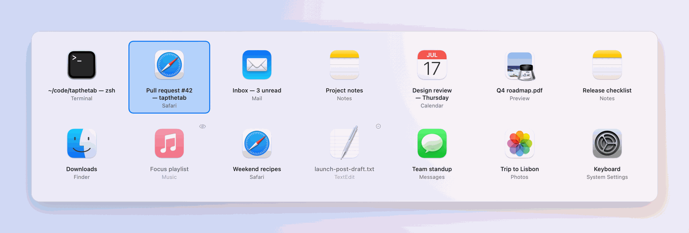
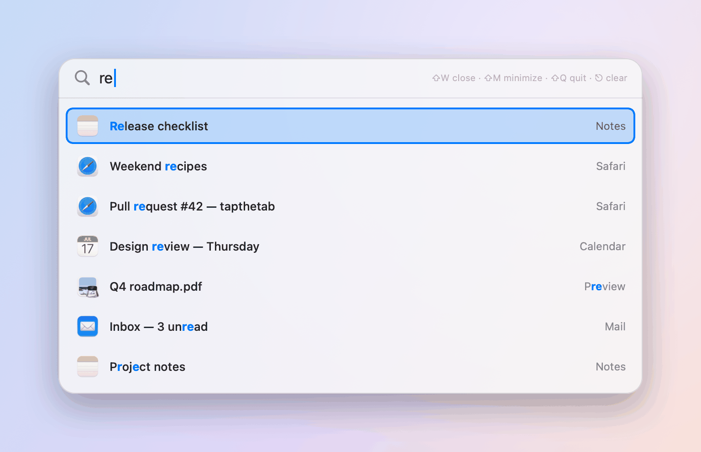
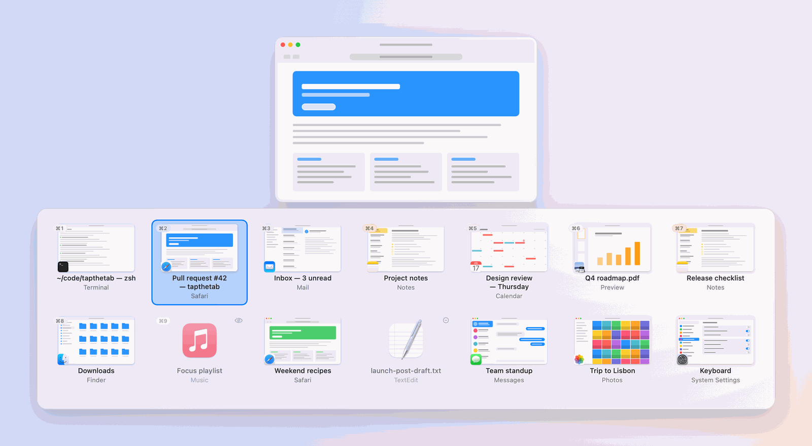
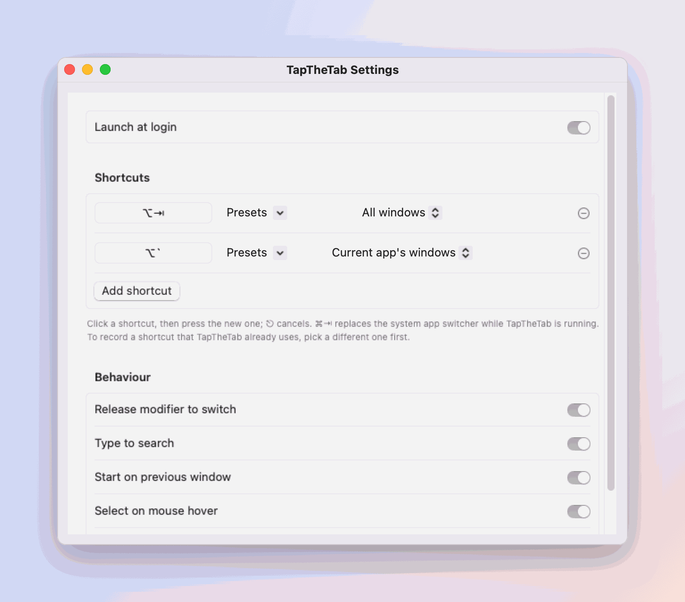

<div align="center">

# TapTheTab

**Every window, one tap away.** A fast, keyboard-first window switcher for macOS.

Hold <kbd>⌥</kbd>, tap <kbd>⇥</kbd>, see every window. Type to search. Let go to switch.

[](https://github.com/memoliertorerr/tapthetab/actions/workflows/ci.yml)
[](https://github.com/memoliertorerr/tapthetab/releases)

[](LICENSE)

</div>

<p align="center">
  <picture>
    <source media="(prefers-color-scheme: dark)" srcset="docs/images/switcher-grid-dark.png">
    
  </picture>
</p>

---

macOS's <kbd>⌘</kbd><kbd>⇥</kbd> switches **apps**, not windows. If you have three Safari
windows and two VS Code projects open, getting to the right one means ⌘⇥, then ⌘\`, then
guessing. TapTheTab shows **every window** in one place, ordered by when you last used it,
and lets you jump to any of them by typing a few letters of its title.

It is a from-scratch take on the idea popularised by [AltTab](https://github.com/lwouis/alt-tab-macos),
built around three goals:

1. **Search first.** Typing while the switcher is open fuzzy-matches window titles *and*
   app names. `⌥⇥ sl ⌥` → Slack. `⌥⇥ gh pull` → the GitHub pull-request tab in whichever
   browser it lives in.
2. **Privacy by default.** No network access, no telemetry, no analytics, ever. Window
   previews are opt-in, so out of the box TapTheTab needs only the Accessibility
   permission, not Screen Recording.
3. **Small and hackable.** A plain-text JSON config, a pure-Swift core with unit tests that
   run on any platform, and a thin macOS layer on top.

## Features

<table>
  <tr>
    <td width="50%">
      <picture>
        <source media="(prefers-color-scheme: dark)" srcset="docs/images/switcher-search-dark.png">
        
      </picture>
      <p align="center"><sub>Type to search — matches are highlighted</sub></p>
    </td>
    <td width="50%">
      <picture>
        <source media="(prefers-color-scheme: dark)" srcset="docs/images/switcher-previews-dark.png">
        
      </picture>
      <p align="center"><sub>Optional live previews</sub></p>
    </td>
  </tr>
</table>

<sub>Screenshots are rendered by the app itself from fictional sample windows
(`make screenshots`), so they always match the current UI.</sub>


- **All windows, most recent first** — including minimized windows and hidden apps
  (each can be filtered out).
- **Type to search** — fuzzy, case- and accent-insensitive, matches titles and app names,
  highlights what matched, and remembers what you picked so it ranks first next time.
- **Same-app switcher** — <kbd>⌥</kbd><kbd>\`</kbd> cycles only the frontmost app's windows.
- **Act without switching** — close, minimize, fullscreen, hide or quit the selected
  window's app straight from the switcher.
- **Quick tap = previous window** — a tap under the show delay (90 ms by default) switches
  back without the panel ever flashing.
- **Group by app** if you like — apps in recency order, each app's windows together.
- **Liquid Glass** — the panel is see-through glass on macOS 26 (Clear or Tinted, like the
  system setting), a similar translucent look on earlier versions, or the classic dark panel.
- **Themes** — Arc-style gradients with grain: eleven presets or your own colors.
- **Move it** — drag the list or the large preview anywhere while the switcher is open;
  it remembers where.
- **Grid or list layout**, three sizes, light/dark/system theme, shows on the display with
  your mouse (or the active window, or the main display).
- **Optional live previews** (macOS 14+, needs Screen Recording): window thumbnails in the
  grid and the list, and a large preview of the selected window on its own floating card
  (50–100 % size).
- **Speaks your language** — English, Italian and Turkish, with VoiceOver support.
- **Scriptable** — `tapthetab://` links open the switcher pre-filtered from launchers,
  Shortcuts or the terminal (see [Automation](#automation)).
- **Use ⌘⇥ if you like** — TapTheTab can take over the system shortcut while it runs and
  hands it back when it quits.
- **Any shortcut you like** — record one in Settings, or edit the config.
- **Always current** — window changes are watched live, so the list is right the moment
  the switcher opens.
- **Menu bar app** with Settings, pause/resume and launch at login.
- **Hand-editable config** that is reloaded live when you save it.

## Install

**Homebrew**

```bash
brew tap memoliertorerr/tapthetab https://github.com/memoliertorerr/tapthetab
brew install --cask tapthetab
```

**Manually**

1. Download `TapTheTab-<version>.dmg` (or `.zip`) from the
   [latest release](https://github.com/memoliertorerr/tapthetab/releases/latest).
2. Drag **TapTheTab** into **Applications** and open it.
3. Grant **Accessibility** when asked (System Settings → Privacy & Security →
   Accessibility). That's the only required permission.

> [!NOTE]
> Release builds are not yet notarized by Apple, so the first launch is blocked by
> Gatekeeper. Either right-click the app → **Open** → **Open**, or go to System Settings →
> Privacy & Security and click **Open Anyway**. From a terminal you can instead run
> `xattr -dr com.apple.quarantine /Applications/TapTheTab.app`.
> Each release lists SHA-256 checksums in `SHA256SUMS.txt`.

> [!TIP]
> Because builds are ad-hoc signed, macOS treats every update as a new app and may ask for
> Accessibility again. If the shortcut stops working after an update, remove TapTheTab
> from the Accessibility list and add it back.

## Using it

| Keys (while holding the trigger modifier) | What happens |
|---|---|
| <kbd>⌥</kbd><kbd>⇥</kbd> | Open the switcher, select the previous window |
| <kbd>⇥</kbd> / <kbd>⇧</kbd><kbd>⇥</kbd> | Next / previous window |
| <kbd>←</kbd> <kbd>→</kbd> <kbd>↑</kbd> <kbd>↓</kbd> | Move around the grid |
| *letters, digits* | Search |
| <kbd>⌫</kbd> | Delete the last search character |
| *release* <kbd>⌥</kbd> | Switch to the selection |
| <kbd>↩</kbd> | Switch to the selection |
| <kbd>⎋</kbd> | Clear the search; press again to close |
| <kbd>Space</kbd> (empty search) | Keep the switcher open after you release <kbd>⌥</kbd> |
| <kbd>⇧</kbd><kbd>W</kbd> | Close the window |
| <kbd>⇧</kbd><kbd>M</kbd> | Minimize / restore the window |
| <kbd>⇧</kbd><kbd>F</kbd> | Toggle fullscreen |
| <kbd>⇧</kbd><kbd>H</kbd> | Hide / show the app |
| <kbd>⇧</kbd><kbd>Q</kbd> | Quit the app |
| <kbd>⌥</kbd><kbd>\`</kbd> | Same thing, but only the current app's windows |

The mouse works too: hover to select, click to switch, click outside to dismiss.

## Configuration

<p align="center">
  <picture>
    <source media="(prefers-color-scheme: dark)" srcset="docs/images/settings-general-dark.png">
    
  </picture>
</p>

Everything in Settings is stored in
`~/Library/Application Support/TapTheTab/config.json` (owner-only permissions). Edit it
by hand if you prefer — TapTheTab reloads it as soon as you save. Unknown or missing keys
fall back to defaults, and a file that can't be read is set aside as
`config.invalid-<timestamp>.json` instead of being overwritten.

```json
{
  "triggers": [
    { "shortcut": "option+tab", "scope": "allWindows" },
    { "shortcut": "option+`",   "scope": "activeApp" }
  ],
  "behavior": {
    "releaseToSwitch": true,
    "searchEnabled": true,
    "startOnPrevious": true,
    "mouseHoverSelects": true,
    "wrapAround": true
  },
  "appearance": {
    "style": "grid",
    "size": "medium",
    "showPreviews": false,
    "windowThumbnails": true,
    "showLargePreview": true,
    "largePreviewPercent": 66,
    "showAppName": true,
    "showMenuBarIcon": true,
    "groupByApp": false,
    "theme": "system",
    "liquidGlass": true,
    "glassStyle": "clear",
    "colorTheme": { "preset": "dusk", "colors": ["#9d8fd0", "#e0a2a0"], "intensity": 0.6, "grain": 0.3, "opacity": 0.55 },
    "placement": "mouse",
    "showDelayMilliseconds": 90
  },
  "filters": {
    "showMinimized": true,
    "showHiddenApps": true,
    "showWindowlessApps": false,
    "currentSpaceOnly": false,
    "currentDisplayOnly": false,
    "showOtherSpaces": false,
    "excludedBundleIDs": ["com.apple.finder"]
  }
}
```

- **Shortcuts** are written as `modifier+…+key`, e.g. `command+tab`, `ctrl+shift+space`,
  `option+grave`. A shortcut needs at least one of ⌘ ⌥ ⌃ fn.
- **Scopes:** `allWindows`, `activeApp` (the frontmost app's windows) and `apps` (one
  entry per app, like ⌘⇥).
- **Styles:** `grid` or `list`. **Sizes:** `small`, `medium`, `large`.
  **Placement:** `mouse`, `activeWindow`, `main`.
- **Look:** `liquidGlass` `true` (glass) or `false` (classic dark panel); `glassStyle`
  `clear` (more see-through) or `tinted` (frosted, more contrast).
  `largePreviewPercent` (25–100) sizes the large preview.
- **Theme:** `colorTheme.preset` is `none`, a preset (`mist`, `sand`, `sage`, `lagoon`,
  `dusk`, `ember`, `orchid`, `glacier`, `meadow`, `berry`, `graphite`) or `custom` (1–3
  `colors`); `intensity`, `grain` and `opacity` go from 0 to 1.
- **Position:** `panelPosition` and `previewPosition` are set when you drag the switcher
  (fractions of the screen); remove them, or use Reset Position, to centre it again.

## Automation

TapTheTab answers to `tapthetab://` links, so launchers (Raycast, Alfred), Shortcuts,
Keyboard Maestro or a terminal can open it:

| Link | Opens |
|---|---|
| `tapthetab://switch` | The switcher, locked open (no key to hold) |
| `tapthetab://switch?query=slack` | The switcher, already searching for "slack" |
| `tapthetab://switch?scope=activeApp` | Only the frontmost app's windows (`allWindows`, `activeApp`, `apps`) |
| `tapthetab://settings` | Settings |

```bash
open "tapthetab://switch?query=pull%20request"
```

Links can only open TapTheTab's own windows; they can never close, quit or move
anything.

## Permissions and privacy

| Permission | Why | Required? |
|---|---|---|
| Accessibility | Listen for the shortcut, list windows, focus/close/minimize them | Yes |
| Screen Recording | Live window previews | Only if you turn previews on |

TapTheTab makes **no network connections** and collects **no data**. It does not read
window contents unless you enable previews, and previews are kept in memory only.
See [SECURITY.md](SECURITY.md) to report a vulnerability.

## Build from source

Requirements: macOS 13+, Xcode 26 (Swift 6.2 toolchain). Xcode 16 still builds the app,
without the system Liquid Glass (the similar translucent look is used instead).

```bash
git clone https://github.com/memoliertorerr/tapthetab.git
cd tapthetab
make test      # unit tests for the core
make app       # builds dist/TapTheTab.app (ad-hoc signed)
make run       # opens it
```

The core logic (`Sources/TapTheTabCore`) is plain Swift and also builds and tests on Linux:
`swift test`.

## How it works

```
 ┌────────────────────── TapTheTab.app (macOS only) ──────────────────────┐
 │ HotkeyMonitor   CGEventTap: trigger detection, key capture while open  │
 │ WindowCatalog   CGWindowList + Accessibility → [SwitcherItem]          │
 │ FocusTracker    app activation + AX focus events → recency order       │
 │ WindowActions   raise / close / minimize / fullscreen / hide / quit    │
 │ ThumbnailService ScreenCaptureKit previews (opt-in, macOS 14+)         │
 │ UI              non-activating NSPanel + SwiftUI, Settings, Onboarding │
 └──────────────────────────────┬─────────────────────────────────────────┘
                                │ plain values
 ┌──────────────────────────────▼──── TapTheTabCore (any platform) ───────┐
 │ SwitcherSession (state machine) · FuzzyMatcher · RecencyTracker        │
 │ ItemFilter · KeyRouter · Shortcut · Configuration/ConfigStore · Grid   │
 └────────────────────────────────────────────────────────────────────────┘
```

More detail in [docs/ARCHITECTURE.md](docs/ARCHITECTURE.md); what's next in
[docs/ROADMAP.md](docs/ROADMAP.md).

## Virtual machines and Windows apps

- **Parallels Desktop in Coherence mode:** each Windows app shows up as its own entry, with
  its own name and icon.
- **CrossOver, Wine, Whisky, Game Porting Toolkit:** each Windows program shows up as its
  own entry (from 0.6.0, including windows that draw their own title bar).
- **UTM, VirtualBox, VMware Fusion, Parallels in window mode, macOS VMs:** you see the VM
  window. The apps inside it are pixels inside that one window — no Mac app can tell them
  apart. Use the guest's own switcher (Alt+Tab in Windows) once you're inside.

Something missing? Copy Diagnostics (Settings → About) lists how many windows were left
out and why, without names.

## Known limitations

- Windows on **other Spaces** are listed only with Settings → Filters → *Show windows on
  other Spaces* (`"showOtherSpaces": true`). It uses private macOS interfaces, is off by
  default, and turns itself off quietly if a macOS update removes them. Without Screen
  Recording, those windows may show the app name instead of the window title until you
  visit their Space.
- Previews require macOS 14 or later; macOS 13 shows app icons.
- Secure input (password fields, some terminals with "Secure Keyboard Entry") blocks all
  global shortcuts, including this one.

## Troubleshooting

**The shortcut does nothing.** Open System Settings → Privacy & Security → Accessibility
and make sure TapTheTab is listed and on. After an update, ad-hoc signed builds can lose
the permission silently: remove TapTheTab from the list with **−** and add it again.

**⌘⇥ stopped working after TapTheTab crashed or was deleted while using ⌘⇥.** Run:

```bash
/Applications/TapTheTab.app/Contents/MacOS/TapTheTab --restore-system-shortcuts
```

(Logging out and back in also restores it.)

**Settings are in a bad state.** Quit TapTheTab and run the line below; your old
`config.json` is kept next to the new one.

```bash
/Applications/TapTheTab.app/Contents/MacOS/TapTheTab --reset-settings
```

**Something else.** Settings → About → **Copy Diagnostics** and paste it into a
[new issue](https://github.com/memoliertorerr/tapthetab/issues/new/choose). It contains
versions, permissions, counts and settings — no window titles or app names.

## Uninstall

1. Quit TapTheTab from its menu (this hands ⌘⇥ back to macOS if you used it).
2. Delete `/Applications/TapTheTab.app` (or `brew uninstall --cask --zap tapthetab`).
3. Optionally delete `~/Library/Application Support/TapTheTab` and remove TapTheTab from
   System Settings → Privacy & Security → Accessibility (and Screen Recording).

## Contributing

Issues and pull requests are welcome — see [CONTRIBUTING.md](CONTRIBUTING.md).

## License

[MIT](LICENSE) © 2026 memoliertorerr.

TapTheTab is an independent project, inspired by AltTab and contains none of its code.
